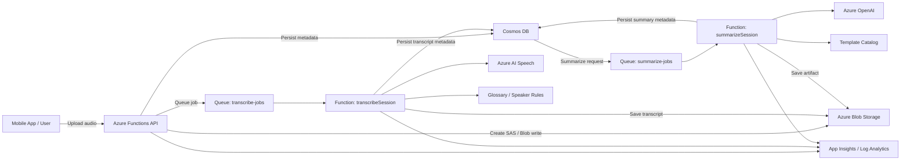

# OrgMate 아키텍처 구성

## 1. 목표

OrgMate는 다음 목표를 만족하도록 설계됩니다.

- 회의 음성 입력을 안전하게 수집한다.
- Azure AI Speech를 통해 고품질 전사를 수행한다.
- 용어 사전과 참석자 수를 반영해 인식 품질을 개선한다.
- 템플릿 기반 요약을 통해 회의록을 자동 생성한다.
- 모든 구성 요소를 서버리스와 IaC로 관리해 운영성과 비용 효율성을 확보한다.

## 2. 아키텍처 다이어그램

## 3. 구성 요소별 역할

### 3.1 모바일 앱

- 녹음 업로드
- 세션 생성 및 조회
- 템플릿 선택
- 용어 사전 관리
- 회의록 결과 표시

이 앱은 오디오 파일 자체를 Azure Blob으로 직접 업로드하는 구조를 채택해 API 경유 대용량 전송을 줄이는 것이 목적입니다.

### 3.2 Azure Functions

- 세션 생성, 업로드 URL 발급, 상태 조회
- 전사 작업 오케스트레이션
- 요약 작업 오케스트레이션
- 관리자용 데이터 관리 API

주요 이점:

- 이벤트 기반 확장
- 트래픽이 적은 시간에도 서버리스로 처리 가능
- 비동기 처리를 통해 사용자 경험 유지

### 3.3 Blob Storage

- 녹음 원본 저장
- 전사 결과 저장
- 산출물(회의록, 요약 파일) 저장

권장 정책:

- ZRS 사용
- blob soft delete 활성화
- 수명주기 정책을 통해 데이터 냉각 단계 관리
- 장기 보존 정책은 규정에 맞게 별도 구성

### 3.4 Cosmos DB

- 세션 메타데이터
- 사용자/템플릿 정보
- 회의록 메타 데이터
- 상태 모델

핵심 원칙:

- 로그/오디오 본문은 Blob에 저장하고, 메타데이터는 Cosmos에 두는 분리 설계
- 검색과 조회가 빠르며 확장성 확보

### 3.5 Azure AI Speech

- Fast Transcription 기반 전사
- diarization 및 phrase list 반영
- expected speaker 수 제어
- 용어 사전 우선순위 반영

이 단계에서 품질 개선이 가장 중요하며, 사용자가 등록한 용어와 화자 카운트 가이드를 반영하는 구조를 갖추고 있습니다.

### 3.6 Azure OpenAI

- 템플릿 기반 정리
- 구조화된 출력 생성
- 회의록/요약 문서 렌더링

요약 결과는 표준 템플릿 구조에 맞춰 생성하고, 필요시 관리자 또는 사용자가 템플릿을 교체할 수 있게 설계합니다.

## 4. WAF 관점 설계 근거

### 4.1 비용 최적화

- 서버리스 함수로 대부분의 처리량을 커버하여 항상 실행되는 VM을 줄임
- 큐 기반 동작으로 스파이크 수요를 평활화
- Blob 수명주기 정책으로 장기 저장 비용 제어
- 필요 시점에만 OpenAI 호출
- 데이터 수집량을 관리 가능한 범위로 제한하는 환경별 구성

### 4.2 보안

- Managed Identity 기반 서비스 간 인증
- Storage와 Cosmos의 로컬 인증 비활성화
- 데이터 평면 접근은 최소 권한으로 제한
- 사용자 단기 SAS는 업로드용으로만 사용
- 관리자와 사용자 역할을 분리할 수 있는 구조 준비

### 4.3 안정성

- Blob ZRS + soft delete
- Queue 재시도와 실패 복구
- Function App에서 오케스트레이션을 분리하여 단일 실패 지점 최소화
- 메타데이터와 산출물 분리로 복구 포인트 확보

### 4.4 운영 우수성

- Bicep으로 인프라 통제
- azd 기반 환경 재현
- 로그/메트릭 기반 관찰 가능성 확보
- 배포 전 검증 절차, 건전성 체크, 수동 롤백 문서화

### 4.5 성능 효율성

- 업로드 후 비동기 작업 실행으로 UX 향상
- 전사와 요약이 각각 독립 스레드에서 동작
- 청크 기반 처리로 대용량 오디오도 분할 처리 가능

## 5. 운영상 설계 권장사항

### 5.1 네트워크

향후 운영 수준으로 가면 다음을 권장합니다.

- Private Endpoints for Storage / Cosmos / AI services
- Function App outbound 제한
- VNet integration 또는 private networking 적용
- DNS/Firewall 정책 강화

### 5.2 보안 강화

- Key Vault에 시크릿 저장
- Managed Identity를 기본 인증 수단으로 고정
- 관리자 API는 Entra 권한 기반 접근 제어
- 민감 데이터는 별도 retention policy 적용

### 5.3 확장성

- 여러 환경(dev/test/prod) 분리
- 리전 확장 가능 구조로 전환
- 템플릿 및 용어 사전 데이터의 조직 단위 분리
- AI 모델 및 Speech 설정을 환경별로 독립 구성

## 6. 확장 방향

다음은 프로덕션 단계에서 자연스럽게 추가될 수 있는 확장 포인트입니다.

- 다중 조직·테넌트 지원
- 멀티 리전 복제 또는 DR
- 고급 보안 모듈(Private Link, Defender for Cloud, Security Center)
- 관리자 콘솔 고도화
- API Gateway 도입
- 데이터 보관 정책 및 규정 준수 관리

## 7. 결론

OrgMate의 구조는 서버리스, 메시지 기반 처리, 안전한 데이터 저장, 템플릿 기반 인공지능 정리의 조합으로 구성되어 있으며, WAF 기준상 비용 효율성과 보안성, 운영 우수성을 동시에 달성하기에 적합합니다. 앞으로는 네트워크 보안, Key Vault, Private Endpoints, 다중 환경 운영, 모니터링 고도화 등의 단계를 통해 생산 환경 수준으로 한 단계 더 성장시킬 수 있습니다.
